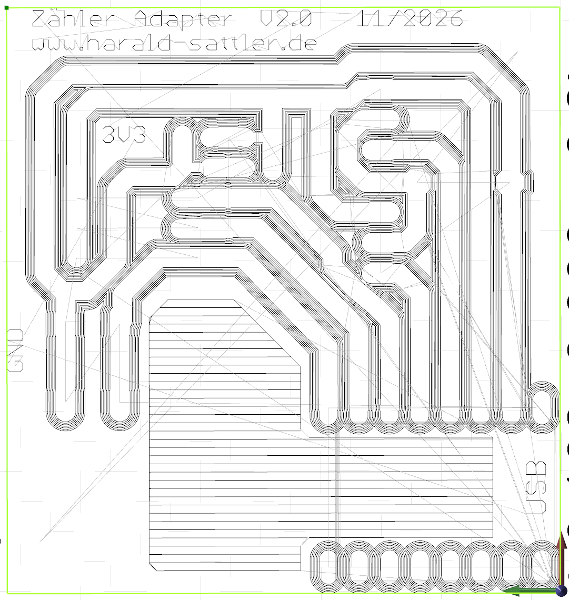
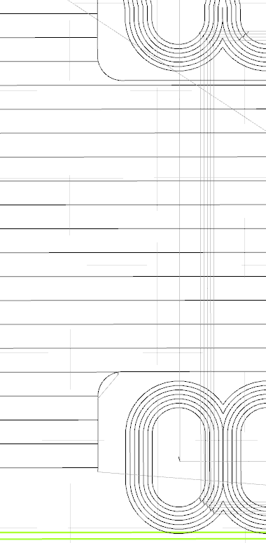
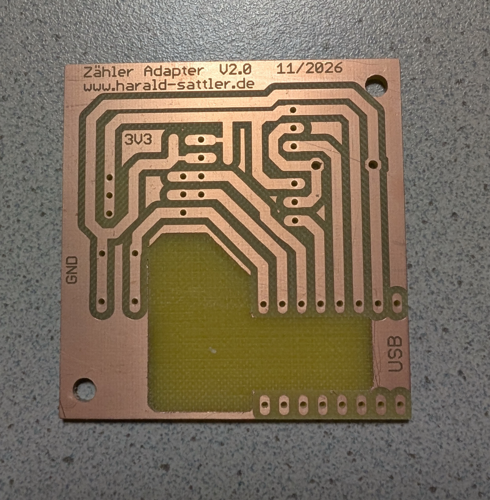

# CopperClear 1.0 for PCB-Gcode (EAGLE 7.7)

CopperClear is an extension to Harald Sattler's PCB-Gcode fork, based on PCB-Gcode 3.7.0. It generates milling paths to remove copper from explicitly defined areas of a PCB, rather than just isolating tracks and pads. Typical applications include RF antenna keep-out areas on carrier boards and other areas where residual copper is undesirable. On a mechanically milled PCB, an empty area in the EAGLE copper layout does not necessarily mean that the physical copper has been removed.

CopperClear generates independent G-code files for each board side. These can be processed with the existing CNC workflow, including surface height compensation in OpenCNCPilot. No modification of OpenCNCPilot is required.

## Installation / upgrading an existing installation

1. Back up the complete PCB-Gcode directory, including `settings/` and `settings/saved/`.
2. Copy the seven source files supplied with this release into the matching paths in your PCB-Gcode installation. This is an update for the deHarro PCB-Gcode fork, not a standalone distribution or an update tested against every upstream version.
3. Open a board in EAGLE and run the independent upgrade ULP **before** opening the normal setup or running PCB-Gcode:

   ```text
   RUN pcb-gcode-copperclear-upgrade
   ```

   The upgrade adds missing settings to the active headers and leaves existing values and stored profiles untouched. It can be run again if needed. The existing backup suffix `.before-copperclear-v02.bak` is retained for compatibility with the tested upgrade routine. Keep your own complete backup as well.
4. Once the upgrade reports success, run `RUN pcb-gcode-setup`.

For repository maintainers: if distributing a complete fresh installation, also add the new declarations to the distributed `settings/pcb-defaults.h` and `settings/pcb-machine.h`, using their configured output units. See `RELEASE-CopperClear.md` for the exact additions. Do not replace users' existing machine settings with those of another installation.

## Defining a copper removal area in EAGLE

Create two user layers in the board editor. The layer names are significant; the numbers are examples and may be changed if already in use:

```text
LAYER 160 tCopperClear;
LAYER 161 bCopperClear;
```

- `tCopperClear`: copper removal on the top side.
- `bCopperClear`: copper removal on the bottom side.

Draw one or more board-level rectangles or closed, non-self-intersecting polygons using straight edges on the appropriate layer. Concave polygons are supported. The outlines specify the maximum intended extent of material removal, not the path of the tool center. Curved polygon edges and shapes defined inside library packages are not supported by this release. Keep each area clear of tracks, pads, holes and other features that must remain intact. Use the appropriate EAGLE restrict layers separately if needed to prevent routing or copper pours in the keep-out area.

## Setup and machining

In **Generation Options**, enable `Generate top copper-clear` and/or `Generate bottom copper-clear`. Both options are disabled by default for migrated legacy profiles.

In **Machine**, set the following parameters independently of etching, pad clearing and board milling:

| Parameter | Default (metric) |
| --- | ---: |
| Copper-Clear tool diameter | 1.4 mm |
| Copper-Clear depth | -0.08 mm |
| Copper-Clear overlap | 50% |
| XY feed rate | 300 mm/min |
| Z feed rate | 100 mm/min |
| Spindle speed | 10,000 rpm |

These are configurable starting values, not universal machining recommendations. Select a tool suitable for copper and the PCB substrate, including axial plunging, and verify its feed, speed and depth for your machine. For example, the water-meter carrier board was milled using a 1.4 mm diamond-cut PCB router with end-cutting teeth. Use appropriate dust extraction when machining FR4.

Accept the settings and run `RUN pcb-gcode` as usual. CopperClear can also run independently of isolation milling. Example output filenames with the configured `.nc` extension:

```text
MyBoard.top.copperclear.nc
MyBoard.bot.copperclear.nc
```

A diagnostic command remains available: `RUN pcb-gcode --copper-clear-test`. It uses the current CopperClear settings, ignores the two generation switches, and produces separate `*.copperclear-test.nc` files for sides containing valid areas.

Inspect the new files in your CNC sender before machining. Reuse the established board origin and orientation; probe the surface and apply height compensation as appropriate. Re-establish the tool Z reference after a tool change. If using the same end mill for CopperClear and board outline milling, perform CopperClear first and cut the board outline last, while the workpiece is still securely held. Separate files allow the operator to combine and order operations in a CNC sender that supports multiple layers.

## Toolpath strategy

- Tool-radius compensation towards the inside of the specified area, plus a small numerical radial allowance (0.005 mm).
- Alternating raster passes with configurable overlap.
- A final contour cleanup pass in clockwise machine XY coordinates, regardless of top/bottom mirroring or original polygon winding. For a clockwise spindle viewed from above, this is conventional milling along an internal boundary.
- Reflex corners use short G1 segments approximating the required radius arc. Cutting moves and connecting moves retain the geometry clearance checks. Narrow or complex outlines can still require retractions or leave inaccessible areas.
- Existing coordinate transformations, offsets and G-code output helpers are reused. Geometry is calculated in millimetres; output supports millimetres (G21) and inches (G20).

## Saved settings and compatibility

Older saved profiles (`.def` and `.mac`) are migrated on loading. Missing milling, pad-clear and CopperClear declarations are added in the profile's own units; existing values are preserved. Load does not rewrite the stored profile itself. Use Save or Save as to persist the migrated settings. Backups of the active headers are made before replacement. The migration expects the usual single-line PCB-Gcode declarations; it is not a general validator for arbitrary edited ULP source.

## Known limitations / safety checks

CopperClear checks the ideal toolpath against the specified area, not against other PCB objects or fixtures. There is no automatic collision detection for traces, pads, holes, board edges or clamps. A finite tool radius and the small numerical allowance can leave residual copper, particularly in sharp corners. Check actual dimensions, cutter runout and machining tolerances. Old output files are not automatically removed if generation is disabled or fails; only use freshly generated, inspected files. Use a dry run and verify your machine setup before cutting.

## Validation status

The integrated V0.2 functionality, setup and legacy profile switching were verified by the maintainer in EAGLE 7.7; the water-meter carrier board was successfully milled. The clockwise finishing direction was confirmed on the bottom side in V0.2a. The final V0.2b reflex-corner changes were checked in the geometry model and visually in OpenCNCPilot. A physical cut using the final V0.2b/V1.0 contour implementation, and a practical top-side test, have not yet been reported. RF performance improvement of the example board remains to be measured; it is not a claim of this release.

This V1.0 package consolidates V0.2 and V0.2b; no machining logic was changed during packaging. Existing PCB-Gcode copyright and license notices remain in force.

## Practical example

The following example shows a copper-free area
created underneath and around the Wi-Fi antenna
of an ESP32-C3 SuperMini module.

### Generated toolpaths in OpenCNCPilot



### Rounded perimeter finishing



The final clockwise finishing pass follows the
contour, including rounded transitions at
concave corners.

### Finished PCB



The copper has been removed using a 1.4 mm
diamond-cut PCB milling bit.